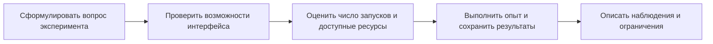
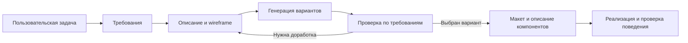

# Лекция 11. Диффузионные модели и визуальное прототипирование

## Раздел 4. Оценка результатов и организация эксперимента

## Слайд 24. Критерии оценки сгенерированного изображения

Перед просмотром результатов определяем, какие свойства важны для задачи. У иллюстрации проверяем содержание, композицию и детали. У интерфейса дополнительно рассматриваем состав экрана, читаемость подписей и заметность основного действия.

Критерии помогают объяснить выбор конкретного варианта. В отчёте указываем, какое требование выполнено и по какому признаку это видно. Для неудачного результата сохраняем описание дефекта, чтобы выбрать действие для следующей итерации.

| Критерий | Вопрос при проверке |
|---|---|
| Соответствие задаче | Присутствуют ли необходимые объекты и блоки? |
| Композиция | Сохранилось ли требуемое расположение? |
| Читаемость | Можно ли прочитать важные подписи? |
| Детали | Есть ли искажения, дубли или пропущенные элементы? |
| Пригодность | Какие доработки нужны для следующего этапа? |

Визуализация. Изображение с пронумерованными отметками, связанными со строками критериев. Это авторская схема проверки.

## Слайд 25. Проверка текста, количества объектов и пространственных связей

Некоторые ошибки становятся заметны при внимательном сопоставлении с условием. Пересчитываем объекты, читаем подписи и проверяем отношения между элементами. Например, кнопка должна находиться внутри нужной карточки, а подпись — относиться к соответствующему полю.

Такие проверки важны для моделей генерации изображений. В ограничениях SDXL отдельно отмечены сложности с читаемым текстом и составными пространственными заданиями. Поэтому нужный признак оценивают на конкретном результате. [Карточка SDXL — ограничения](https://huggingface.co/stabilityai/stable-diffusion-xl-base-1.0#limitations-and-bias).

| Что задано | Как проверяем |
|---|---|
| Три карточки | Пересчитываем различимые карточки |
| Название раздела | Читаем все символы в подписи |
| Панель слева от списка | Проверяем взаимное расположение блоков |
| Кнопка в каждой карточке | Проверяем наличие и принадлежность каждой кнопки |

Визуализация. Учебный макет с тремя разными дефектами — искажённой подписью, отсутствующей кнопкой и лишней карточкой. Перед разбором предложите найти их по требованиям.

## Слайд 26. Контролируемое A/B-сравнение

Для сравнения заранее формулируем гипотезу и выбираем один изменяемый фактор. Например, предполагаем, что уточнение инструкции сделает кнопку основного действия заметнее. Описание задачи и остальные доступные настройки сохраняем одинаковыми.

Результаты A и B проверяем по одной рубрике. Это позволяет связать наблюдение с запланированным изменением. Важно сохранять и исходные PNG, и точные запросы, чтобы позже вернуться к условиям опыта.

| Условие опыта | Вариант A | Вариант B |
|---|---|---|
| Исходник | Один wireframe | Тот же wireframe |
| Seed | 42 | 42 |
| Число шагов | 20 | 20 |
| Инструкция | Базовое оформление | Добавлено требование выделить основную кнопку |
| Оценивание | Общие критерии | Те же критерии |

Примечание преподавателю. Это пример протокола. Таблица задаёт условия будущего опыта и не содержит результатов измерения. Значения параметров выбирают с учётом конкретной модели и API.

## Слайд 27. Повторение на других seed и пределы выводов

Одна пара изображений показывает поведение при конкретном случайном старте. Если ресурсы позволяют, повторяем A/B на нескольких seed и смотрим, сохраняется ли преимущество. В каждой паре используем одинаковый seed для обоих вариантов. [Diffusers — управление случайностью](https://huggingface.co/docs/diffusers/using-diffusers/reusing_seeds).

После первоначального сравнения можно зафиксировать выбор и проверить его на новом seed. Если результат меняется, описываем условия, в которых решение оказалось удачным или неудачным. При небольшом числе запусков вывод формулируем в пределах исследованных примеров.

Визуализация. Сетка пар A/B для seed 17 и 23. Отдельно показана пара для seed 101, полученная после фиксации выбора. Реальные изображения сопровождаем настройками и наблюдениями, а схематичные рамки подписываем как план эксперимента.

## Слайд 28. Фиксация настроек, происхождение результатов и кэш

Для каждого изображения сохраняем описание входа, настройки и сведения об инструменте. В локальном запуске можно записать модель, ревизию весов и версии библиотек. Для удалённого сервиса фиксируем название модели или приложения и параметры, которые он действительно предоставляет.

Кэш позволяет повторно открыть уже полученное изображение. Такой результат связываем с сохранёнными условиями прогона. При анализе времени и числа обращений отдельно отмечаем повторное использование кэша и затраты первоначальной генерации.

| Что сохраняем | Зачем это нужно |
|---|---|
| Исходный PNG и его контрольная сумма | Связать результат с конкретным каркасом |
| Запрос и параметры | Восстановить постановку опыта |
| Модель, ревизия и доступные сведения о среде | Описать условия выполнения |
| Итоговое изображение и ID прогона | Найти проверяемый результат |
| Ручная оценка и комментарий | Обосновать решение по этому изображению |

Примечание преподавателю. Если сервис сообщает только ревизию приложения, так и указываем в отчёте. Степень воспроизводимости зависит от доступного контроля над моделью и средой. [Diffusers — воспроизводимость](https://huggingface.co/docs/diffusers/using-diffusers/reusing_seeds).

## Слайд 29. Веса модели, выполнение и удалённый API

Выбор модели связан с выбором способа её выполнения. Можно получить веса из репозитория и запустить модель в собственной вычислительной среде, например в Colab. При обращении к удалённому API вычисления выполняет сервис, а приложение передаёт входные данные и получает результат.

На Hugging Face эти возможности представлены разными частями платформы. Model Hub хранит репозитории моделей, Inference Providers предоставляет доступ к удалённым поставщикам, а Spaces размещает приложения и демонстрации. Для выбранного способа отдельно проверяют доступность нужной задачи и параметры. [Model Hub](https://huggingface.co/docs/hub/models-the-hub), [Inference Providers](https://huggingface.co/docs/inference-providers/index), [Spaces](https://huggingface.co/docs/hub/spaces-overview).

| Способ работы | Где выполняется модель | Что нужно подготовить |
|---|---|---|
| Запуск весов в Colab | В вычислительной среде пользователя | Библиотеки, веса и доступное оборудование |
| API поставщика | На стороне поставщика | Клиент, авторизацию и параметры запроса |
| API публичного Space | В приложении владельца Space | Доступ к приложению и его схему API |

Примечание преподавателю. Colab предоставляет вычислительные ресурсы с ограничениями доступности. Для бесплатного GPU учитываем возможность получить его перед занятием. [Условия Colab](https://research.google.com/colaboratory/faq.html).

## Слайд 30. Доступные параметры, очередь, квота и бюджет эксперимента

До запуска проверяем, какие входы и настройки принимает выбранный интерфейс. Один сервис может предоставлять image-to-image со strength, другой — редактирование изображения по текстовой инструкции. План опыта строим на параметрах, доступных в этом интерфейсе.

Затем определяем минимальное число нужных обращений и сохраняем успешные результаты. Для удалённого сервиса учитываем очередь, квоту и допустимую длительность запуска. Время ответа API может включать ожидание и передачу файлов, поэтому в отчёте поясняем, что именно измерено. [Условия ZeroGPU](https://huggingface.co/docs/hub/spaces-zerogpu).

Примечание преподавателю. На 8 ноября 2026 года Inference Providers не включает кредиты для бесплатных аккаунтов. В ZeroGPU для бесплатного аккаунта указана дневная квота 5 минут GPU, при этом действуют очередь и ограничения отдельного запуска. Условия проверяют перед занятием. [Тарифы Inference Providers](https://huggingface.co/docs/inference-providers/pricing), [квоты ZeroGPU](https://huggingface.co/docs/hub/spaces-zerogpu).

## Итоговый разбор

## Слайд 31. Разбор макета по требованиям и выбор следующего действия

В учебном примере требовались три карточки, панель фильтров слева и заметная кнопка в каждой карточке. Вариант B сделал кнопки заметнее, но сохранил только две карточки. При разборе фиксируем и улучшение, и нарушение требования.

Следующую итерацию направляем на конкретный дефект. Можно уточнить число карточек в инструкции или изменить каркас и снова проверить весь список требований. Если макет выбирается для дальнейшей разработки, к нему прилагают перечень необходимых исправлений.

| Требование | Наблюдение в учебном примере | Следующее действие |
|---|---|---|
| Три карточки | Сохранились две | Восстановить состав экрана |
| Панель слева | Расположение сохранено | Проверить после следующей итерации |
| Заметная кнопка | Визуальный акцент появился | Сохранить удачное решение |

Визуализация. Авторский макет для обсуждения с отмеченными наблюдениями. Пример является учебной ситуацией, а не отчётом о реальном сравнении моделей.

## Слайд 32. Путь от задачи к проверенному прототипу

Работа начинается с пользовательской задачи и требований. Затем подготавливаем описание или визуальный каркас, выбираем подходящий способ генерации и получаем варианты. Проверка показывает, какие требования выполнены и что нужно изменить.

Для следующего этапа сохраняем выбранный макет, условия его получения и результаты оценки. Описание компонентов, данных, действий и состояний помогает перейти к реализации и проверке поведения приложения.

